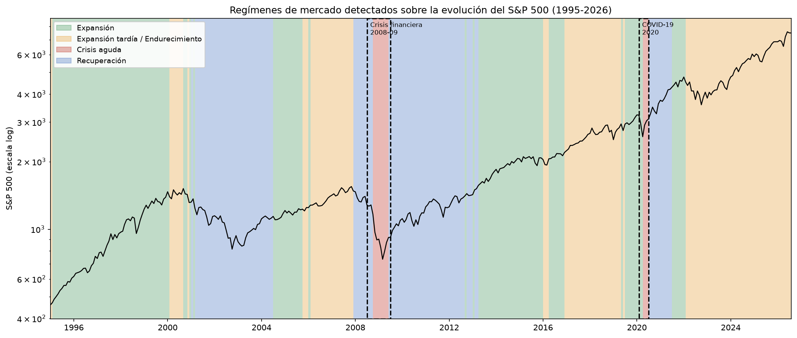
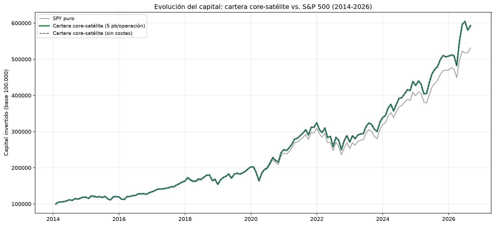

🇪🇸 [Versión en español](README.es.md)

# Market regime detection with machine learning for tactical asset allocation

Master's thesis — Master's in Data Science, Big Data & Business Analytics - Universidad Complutense de Madrid
Íñigo Ochoa Gil

> Module, function and variable names in the code are in Spanish, and so are the labels in the figures.

## Objective

Detect the prevailing macro-financial regime through unsupervised clustering, use it together
with cross-sectional signals as input to predict which Fama-French factors
(+ Momentum + BAB) will perform best at different horizons (short,
medium and long term), and translate those predictions into a _long-only_
equity portfolio on the S&P 500.

## Main results



Only 12-month Momentum shows statistically significant directional accuracy
(R² = 0.174, directional accuracy = 70.8%, p = 0.0011, binomial test) on the
out-of-sample test set (observations after 2019-12-31, not used in training).
This figure comes from a single chronological train/test split
(`src/factor_prediction/evaluacion_baseline.py`), not from a multi-fold
walk-forward validation: the walk-forward
(`src/backtesting/walk_forward_capa2.py`) is used to generate the Momentum
predictions that feed the portfolio, not to recompute this significance
metric. The remaining factor/horizon combinations (21 in total:
7 factors × 3 horizons) do not significantly beat the benchmarks (constant
zero prediction and constant prediction equal to the training-set historical
mean). The market regime, although valid as a standalone classifier in
Layer 1, adds no incremental signal in Layer 2.



Final portfolio (history up to August 2026, with 5 bp transaction costs) vs. SPY:

| Metric                       | Portfolio | SPY (benchmark) |
| ---------------------------- | --------- | --------------- |
| Annualised return (CAGR)     | ~15.2%    | ~14.2%          |
| Sharpe                       | ~1.003    | ~0.991          |
| Calmar                       | ~0.661    | ~0.593          |
| Maximum drawdown             | ~-23.0%   | ~-23.9%         |

The capital advantage over SPY is small and reverses in some years between
2014 and 2019 (portfolio/SPY ratio between 0.99 and 1.01); it builds up
mainly from 2020-2021 onwards (year-end ratio: 1.04 in 2020, 1.05 in 2021,
1.07 in 2022, up to 1.12 in August 2026).

The advantage holds in all five cost scenarios tested (0, 5, 10, 20 and
50 bp per trade): the portfolio's Sharpe ranges roughly from 0.997 (50 bp)
to 1.004 (0 bp) — read from the chart
`figura_5_sensibilidad_costes.png`, since `sensibilidad_costes_transaccion.csv`
is not versioned in the repo and cannot be recomputed without the turnover
history — and in every scenario it stays above that of plain SPY (0.991).

## Pipeline architecture

```
Data (Yahoo Finance, FRED, Kenneth French, AQR, AAII, Sharadar)
        │
        ▼
Layer 1 — Regime detection
  clustering (k-means, k=4) on 19 macro/market variables → historical regime
                                labels (Expansion, Late expansion/Tightening,
                                Acute crisis, Recovery)
  Random Forest + SHAP       → classifies the regime of a new month and explains it

        │
        ▼
Layer 2 — Factor prediction (Random Forest, one per horizon)
  Input:  macro variables + cross-sectional signals
          (relative strength, valuation composite, dispersion, value spread)

  Output: expected return of the 7 factors at 3 horizons (~1, ~3, ~12 months)
        │
        ▼
Portfolio construction (core-satellite: passive SPY + top-15 Momentum satellite)
        │
        ▼
Backtesting (walk-forward / expanding window)
  Sharpe ratio · Maximum drawdown · Calmar ratio
        │
        ├──► Monthly batch
        └──► API (FastAPI)
              GET /health               → service status
              GET /prediccion-factores → serves the current prediction/tilt (cached)
              POST /recalcular-factores → forces recalculation, protected with X-API-Key
              GET /cartera-acciones    → serves the current stock turnover (cached)
              POST /recalcular-cartera → forces recalculation, protected with X-API-Key
```

## Target factors

7 factors:
Fama-French 5 (Mkt-RF, SMB, HML, RMW, CMA) + Momentum (Kenneth French Data
Library) + BAB, Betting Against Beta (AQR Data Library)

## Stock universe and scope

S&P 500, using its _point-in-time_ constituents (avoiding survivorship bias). Universe
selection is isolated in a single place in the code so it can be extended
in the future without refactoring the rest of the pipeline.

## Time range

The download of macro and market variables for Layer 1 starts in 1990
(`FECHA_INICIO` in `config/series.py`), but the effective panel that feeds
the regime clustering only has complete data from late 1994 / 1995, because
several features use a 60-month rolling window (z-scores) that consumes the
first 5 years as warm-up; hence the regime figure is titled "1995-2026".
For the cross-sectional signals and the Layer 2 training panel the effective
range is 1998–2026
(`FECHA_INICIO_CAPA2 = "1998-03-31"` in `src/features/panel_maestro_capa2.py`),
bounded by the actual coverage of Sharadar's historical S&P 500 constituents
table. Weekly series (initial jobless claims and the AAII survey) are
aggregated to monthly before being merged into the panel.

## Repository structure

```
README.md           English version
README.es.md        Spanish version
pyproject.toml
requirements.txt
.env / .env.example

config/             Data series mapping and data paths
data/               raw / processed / external (not versioned in git except
                    5 aggregated outputs required for Option B, see below)
models/             Pre-trained models (Layer 1 regime + 3 Layer 2 RFs, one per
                    horizon), to reproduce without Sharadar
src/
  data_ingestion/   Download of market, macro, factor and fundamental data
  features/         Construction of regime and cross-sectional features
  preprocessing/    Series alignment
  regime/           Clustering (k-means) and RF+SHAP classifier
  factor_prediction/  Forward-return target and per-horizon models
  backtesting/      Walk-forward / expanding window (Layer 2)
  portfolio/        Portfolio construction, weights, capital evolution,
                    cost sensitivity
api/                FastAPI API (prediction/tilt and stock portfolio)
scripts/            reproducir.sh (Option B) and model
                    training/export utilities
viz_exports/        Supporting PNGs
notebooks/          Walkthrough notebook that reproduces 4 of the 5 main
                    figures of the thesis (all except cost sensitivity) from
                    the artefacts already computed by src/ (it does not
                    reimplement the pipeline)
reports/
  figuras/          Final thesis charts (regimes, SHAP,
                    R²/accuracy by factor, capital evolution,
                    cost sensitivity) + EDA charts
```

## Data sources by phase

| Phase                  | Fundamentals                                                         | Prices        | Macro / Factors                 |
| ---------------------- | -------------------------------------------------------------------- | ------------- | ------------------------------- |
| Training / backtesting | Sharadar (point-in-time)                                             | Yahoo Finance | FRED, Kenneth French, AQR, AAII |
| Production (post-thesis) | SEC EDGAR (required, no sign-up) + Finnhub (optional, validation) | Yahoo Finance | FRED, Kenneth French, AQR, AAII |

Sharadar is only used to build the historical training dataset —
the trained model does not depend on the subscription once that phase is complete.

## How to run

```bash
conda create -n tfm-regimen python=3.11 -y
conda activate tfm-regimen
pip install -e .
pip install -r requirements.txt

cp .env.example .env                # Fill in FRED_API_KEY (required for
                                    # Option A), TFM_API_KEY (protects the
                                    # API's POST endpoints) and, if used, FINNHUB_API_KEY
```

### Option A — Full replication (requires a Sharadar subscription)

Regenerates the data and retrains the models from scratch. In addition to the above,
fill in `SHARADAR_API_KEY` in `.env` — without it, this block fails.

```bash
# Experiment tracking (optional, opens a local dashboard)
mlflow ui

# 1. Raw data ingestion (-> data/raw/)
python -m src.data_ingestion.fred_loader
python -m src.data_ingestion.loaders                # AQR BAB + Kenneth French + AAII

python -c "from data_ingestion.sharadar_loader import guardar_universo_sharadar; guardar_universo_sharadar()"
python -c "from data_ingestion.sharadar_loader import guardar_fundamentals_arq; guardar_fundamentals_arq()"
python -c "from data_ingestion.sharadar_loader import guardar_precios_delistados; guardar_precios_delistados()"

python -c "from data_ingestion.yahoo_loader import descargar_todas_series_yahoo; descargar_todas_series_yahoo()"
python -c "from data_ingestion.yahoo_loader import guardar_precios_individuales_yahoo; guardar_precios_individuales_yahoo()"

# 2. Preprocessing and Layer 1 (regime) (-> data/processed/)
python -m src.preprocessing.alineacion
python -m src.features.macro
python -m src.features.cross_sectional
python -m src.regime.kmeans_regimen
python -m src.regime.regimen_sin_leakage

# 3. Layer 2 features
python -m src.features.fundamentales_pit
python -m src.features.precios_pit
python -m src.features.pipeline_senales_capa2
python -m src.features.panel_maestro_capa2

# 4. Layer 2 target and training (requires mlflow ui running or tracking configured)
python -m src.factor_prediction.target
python -m src.factor_prediction.entrenamiento       # registers rf_corto_final / rf_medio_final / rf_largo_final in MLflow

# 5. Backtesting and portfolio
python -m src.backtesting.walk_forward_capa2
python -m src.portfolio.pesos_cartera
python -m src.portfolio.ejecutar_cartera_acciones --modo walk_forward
python -m src.portfolio.extender_historico_reciente

# Start the API
uvicorn api.main:app --reload
# Interactive docs at http://127.0.0.1:8000/docs

# Pre-compute the cache served by the GET endpoints (requires TFM_API_KEY in .env)
curl -X POST http://127.0.0.1:8000/recalcular-factores -H "X-API-Key: $TFM_API_KEY"
curl -X POST http://127.0.0.1:8000/recalcular-cartera  -H "X-API-Key: $TFM_API_KEY"
```

Sharadar requires a paid subscription and the `fundamentals` step downloads
~620MB, so that stage is the most expensive to replicate from scratch. All
other sources (FRED, Yahoo Finance, Kenneth French, AQR, AAII, and SEC
EDGAR/Finnhub in production) are free.

### Option B — Reproduce with the pre-trained models (no Sharadar)

To verify the results **without any Sharadar subscription**,
using the pre-trained models (`models/`) and the pre-computed outputs
(`data/processed/`) included in the repo. Neither `SHARADAR_API_KEY` nor
`FRED_API_KEY` is needed.

```bash
bash scripts/reproducir.sh
```

The script checks that the required files are present, installs dependencies,
loads the 4 pre-trained models, starts the API serving from cache,
validates the `GET` endpoints, and runs the walkthrough notebook, regenerating 4
of the 5 main figures (all except cost sensitivity, which
requires the turnover history not versioned in the repo), without accessing
Sharadar at any step.

## Main references

- "The Promises and Pitfalls of Factor Timing." _The Journal of Portfolio
  Management_, 44(4) (2018).
- "Factor Timing with Cross-Sectional and Time-Series Predictors." _The
  Journal of Portfolio Management_ (2017).
- "Machine Learning and Data Science Blueprints for Finance." O'Reilly Media
  (2020).
- "Advances in Financial Machine Learning." Wiley (2018).
- "Empirical Asset Pricing via Machine Learning." _The Review of Financial
  Studies_ (2020).
- "A Unified Approach to Interpreting Model Predictions." _Advances in Neural
  Information Processing Systems_ (2017).
- "Returns to Buying Winners and Selling Losers: Implications for Stock
  Market Efficiency." _The Journal of Finance_ (1993).
